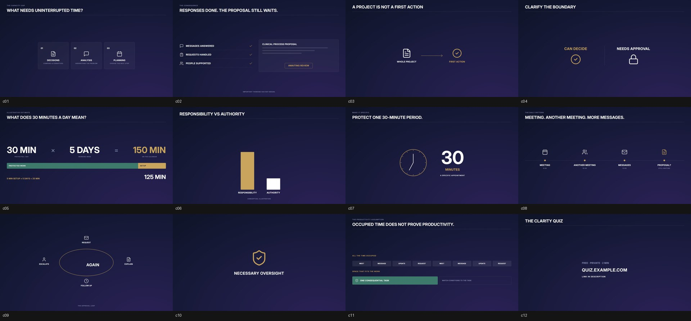

# Thang-Talking-head

Skill cho Claude Code dựng video **talking-head kiểu coaching / giáo dục**: một người nói trước camera (1-2 góc máy), xen card đồ họa động nền navy chữ trắng điểm vàng, chữ chốt viết hoa, B-roll, logo góc, card kêu gọi cuối. Từ footage thô ra `final.mp4` và timeline DaVinci Resolve chỉnh tiếp được.



## Làm được gì

| Bước | Script | Kết quả |
|---|---|---|
| Đồng bộ 2 máy | `sync.py` | độ lệch máy B so với A, tính từ âm thanh |
| Chép lời theo từ | `transcribe.py` | faster-whisper offline, giữ cả từ đệm |
| Cắt thô | `rough_cut.py` | bỏ khoảng lặng, từ đệm, câu nói lại; tự đổi góc máy; `cut_review.md`, `timeline.md` |
| Màu | `grade.py` | cân trắng theo tường, chỉnh nhẹ ±8%, khớp màu máy B với A; ảnh trước/sau |
| Đồ họa | `render_cards.py` | 12 bố cục card HTML → MP4, chuyển động khớp từng từ; chữ chốt PNG trong suốt |
| B-roll | `fetch_broll.py` | clip Pexels có giấy phép + credits.csv |
| Kiểm tra | `check_plan.py`, `sheet.py` | lỗi plan, độ phủ card, contact sheet, loudness |
| Render | `render.py` | ghép lớp, hòa tan, logo, voice chain, nhạc, SFX, −14 LUFS, outro |
| Resolve | `resolve_build.py` | timeline 5 track hình + 2 track tiếng, dissolve, CDL màu |

Đồ họa viết bằng code (HTML/CSS/SVG, chụp từng frame qua Chromium), nên đổi chữ, màu, font, nhịp chỉ là sửa JSON; card không đổi thì không render lại.

## Cài đặt

Cần Python 3.10+, ffmpeg 6+ trong PATH.

```bash
git clone https://github.com/tinhkiemcn1-spec/Thang-Talking-head
```

```bash
python Thang-Talking-head/install.py
```

install.py cài thư viện (`faster-whisper`, `numpy`, `pillow`, `playwright`), Chromium cho Playwright, chép skill vào `~/.claude/skills/thang-talking-head` và cài menu script vào DaVinci Resolve.

B-roll Pexels (tùy chọn): chép `.env.example` thành `.env` và điền `PEXELS_API_KEY` (miễn phí ở pexels.com/api).

## Dùng

Trong Claude Code:

```
/thang-talking-head dựng video từ D:\shoot\front.mp4 và D:\shoot\side.mp4, logo D:\shoot\logo.png, font oswald
```

Claude sẽ hỏi phần còn thiếu, chép lời, đưa bản cắt thô để duyệt, lên plan card theo lời nói, render preview cho xem rồi mới xuất bản cuối. Chi tiết trong [SKILL.md](SKILL.md).

Chạy tay từng bước:

```bash
python -X utf8 scripts/sync.py front.mp4 side.mp4 --edit edit
python -X utf8 scripts/transcribe.py front.mp4 edit --lang en
python -X utf8 scripts/rough_cut.py edit
python -X utf8 scripts/grade.py edit
# viết cards/captions/broll vào edit/plan.json (xem references/)
python -X utf8 scripts/check_plan.py edit
python -X utf8 scripts/render_cards.py edit --stills
python -X utf8 scripts/render_cards.py edit
python -X utf8 scripts/render.py edit --preview
python -X utf8 scripts/render.py edit
python -X utf8 scripts/resolve_build.py edit --name "Video 01"
```

## Tài liệu

- [references/phan-tich-mau.md](references/phan-tich-mau.md): phân tích phong cách bộ mẫu, số liệu nhịp, màu, âm thanh
- [references/plan-format.md](references/plan-format.md): định dạng `plan.json`
- [references/card-layouts.md](references/card-layouts.md): 12 bố cục card và khi nào dùng
- [examples/](examples/): `cards_gallery.json` (đủ 12 bố cục), `demo_plan.json` (plan hoàn chỉnh)

## Nguồn

Kế thừa ý tưởng và quy tắc từ [Thang-Edit](https://github.com/tinhkiemcn1-spec/Thang-Edit) (dựa trên video-use của Browser Use) và [video-anime](https://github.com/tinhkiemcn1-spec/video-anime). Xem [NOTICE](NOTICE). MIT License.
